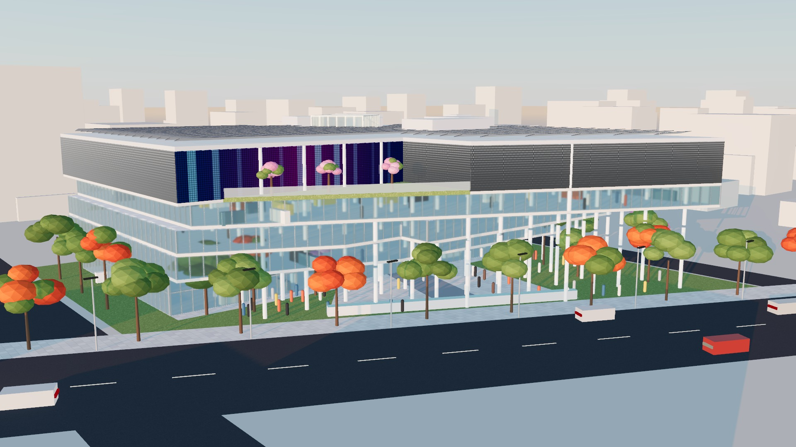
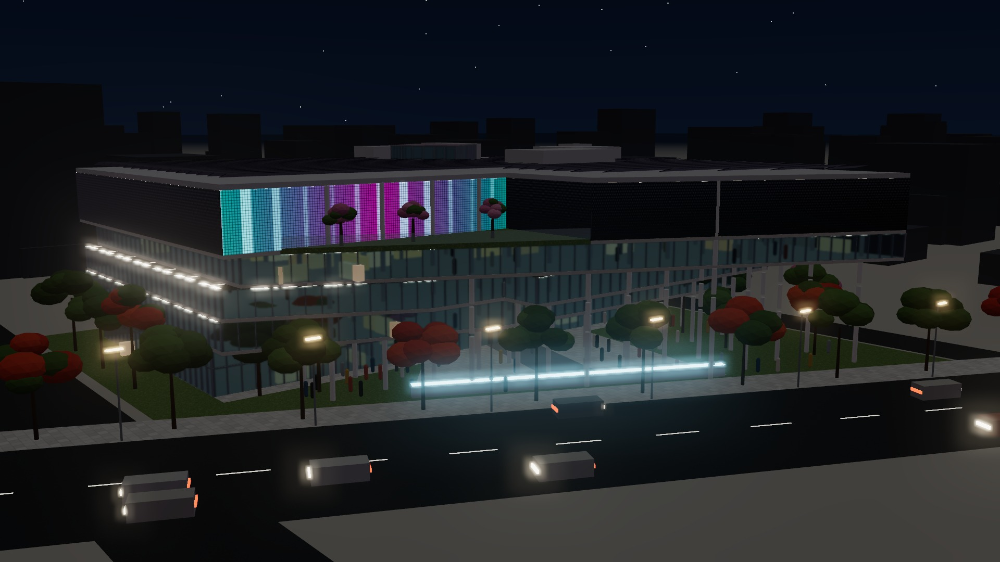
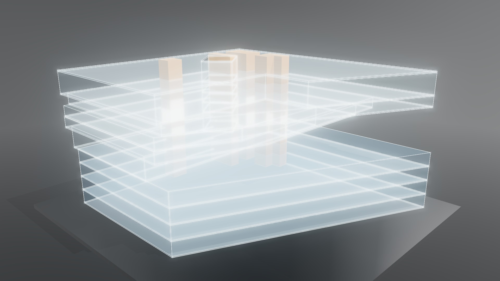
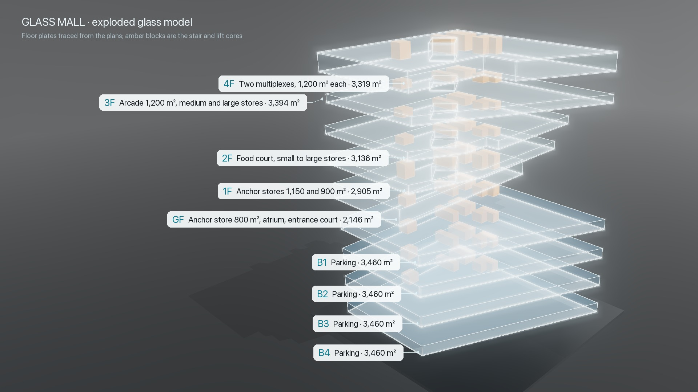
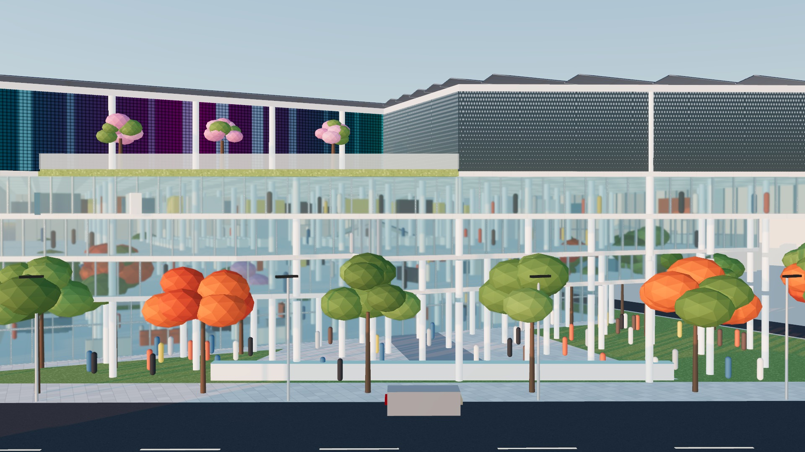

# Glass Mall

A 3D glass model of a G+4 shopping mall with four basements, traced from the floor plans of an Architectural Design V project (plans by Harsha J.V, K.S. School of Architecture). It runs in the browser with three.js.



| | |
|---|---|
|  |  |
|  |  |

## What's in the model

Every floor outline was traced from the drawings at 11.7 px per metre, using the 24.4 m dimension on the ground-floor anchor store as the reference.

| Level | Height | Use (from the plans) | Plate |
|---|---|---|---|
| 4F | +15.0, 6 m | Two multiplexes, 1,200 m² each | 3,319 m² |
| 3F | +12.0, 3 m | Arcade 1,200 m², medium and large stores | 3,394 m² |
| 2F | +9.0, 3 m | Food court, small to large stores | 3,136 m² |
| 1F | +6.0, 3 m | Anchor stores 1,150 and 900 m² | 2,905 m² |
| GF | ±0.0, 6 m | Anchor store 800 m², atrium, entrance court | 2,146 m² |
| B1–B4 | −4 to −16 m | Parking | 3,460 m² each |

- **Atrium:** an 8 × 8 m square turned 39°, with escalators on two sides. It runs through every floor to a glazed skylight.
- **Cantilevers:** the upper floors cantilever over the entrance court on columns, and the east multiplex projects past the diagonal site edge.
- **Added for the visualisation, not in the plans:** curtain-wall details, fritted glass on the multiplexes, an LED media screen, roof solar panels, a roof terrace, interior fittings, people, landscape and the surrounding city.

## Run it

```bash
python3 serve.py
```

Then open http://localhost:8766. `index.html` is a page fragment (no `<html>` or `<head>`); `serve.py` adds the wrapper when it serves it.

**Controls:**
- **Mode:** switch between the realistic glass building and the glass model.
- **Light:** day, golden hour or night.
- **Floors:** explode the floors apart, or click a level to cut the building down to it.

*Concept visualisation for a student design project, not for construction.*
